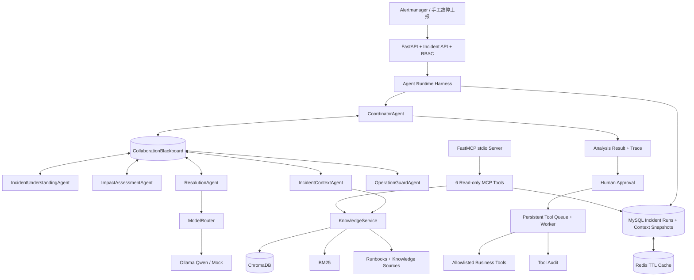

# NexusOps 研发运维故障研判与协同处置平台

NexusOps 是面向研发与 SRE 场景的多 Agent 故障研判与协同处置平台，提供监控告警接入、Incident 管理、影响评估、运维知识检索、根因假设生成、人工审批、受控工具队列和审计追踪。

项目重点不是让大模型直接操作生产环境，而是将故障理解、影响评估、知识证据、根因分析和安全审查拆分为不同 Agent，由 CoordinatorAgent 通过 Blackboard 组织协作，并将所有写操作放入受控业务流程。

> **安全边界：** 模型输出是待验证的故障假设，不是已确认根因。OperationGuard 不执行 Shell、生产服务重启、数据库变更或自动回滚。高风险操作只记录审批请求，由有权限的运维人员在 NexusOps 之外按组织流程执行。

## 项目亮点

- **事件驱动多 Agent Runtime：** 1 个 CoordinatorAgent + 5 个专业 Agent，通过 CollaborationBlackboard 进行任务 Claim、Artifact 发布和结果采纳。
- **上下文管理：** MySQL 保存 Incident 级版本化上下文快照，Redis 提供按 Incident 隔离的 TTL 缓存；支持缓存失效、历史版本恢复和近似 Token 预算裁剪。
- **Hybrid RAG：** ChromaDB 向量召回与 BM25 关键词召回加权融合；支持 Runbook 来源状态、版本 Hash、证据引用及来源多样性约束。
- **模型可靠性：** ModelRouter 提供 CLOSED、OPEN、HALF_OPEN 三态熔断、超时、Fallback 和 SSE 首 Token 安全保护。
- **MCP 与受控工具：** FastMCP Server 暴露只读运维工具；独立的 MySQL Tool Queue 处理允许的业务写操作，并提供幂等、重试、恢复、审批和审计。
- **工程验证：** pytest 单元/API 测试、RAG 离线评测、Webhook 去重脚本和 HTTP 端到端验证。

## 架构概览



### Agent 分工

| Agent | 职责 | 主要实现方式 |
|---|---|---|
| CoordinatorAgent | 任务调度、Blackboard 管理、专业结果检查与最终采纳 | 事件驱动调度 |
| IncidentUnderstandingAgent | 故障现象理解、结构化字段提取 | 规则与结构化处理 |
| ImpactAssessmentAgent | 影响范围分析、影响分数与严重等级建议 | 规则评分 |
| IncidentContextAgent | Runbook 检索、证据筛选、知识缺口识别 | Chroma + BM25 |
| ResolutionAgent | 根因假设、排查步骤、验证方式和证据缺口生成 | ModelRouter 调用配置的模型 |
| OperationGuardAgent | 操作风险识别、权限边界和人工审批判断 | 规则安全审查 |

当前主要大模型推理集中在 ResolutionAgent；不应将项目描述为六个 Agent 均由大模型独立驱动。

## 技术栈

`Python` · `FastAPI` · `SQLAlchemy` · `MySQL 8` · `Redis 7` · `ChromaDB` · `BM25` · `Ollama` · `Qwen2.5-3B` · `FastMCP` · `Docker Compose` · `pytest`

## 目录结构

```text
NexusOps/
├── .github/workflows/       # GitHub Actions
├── app/
│   ├── agents/              # Coordinator、专业 Agent、Blackboard 与事件
│   ├── api/                 # Incident、Webhook、审批、知识和工具 API
│   ├── core/                # 配置、数据库、安全和启动逻辑
│   ├── knowledge_ops/       # 内置运维 Runbook（运行时知识数据）
│   ├── mcp_tools/           # FastMCP 只读工具 Server
│   ├── models/              # SQLAlchemy 数据模型
│   ├── rag_eval/            # RAG 评测代码和小型评测集
│   ├── schemas/              # API DTO
│   ├── services/             # RAG、上下文、模型路由、队列等服务
│   └── static/               # Web 前端
├── data/                     # 本地持久化目录；仓库仅保留 .gitkeep
├── docs/evaluation/          # 可复核的 RAG 评测 JSON 报告
├── migrations/               # Alembic 数据库迁移
├── scripts/                  # 初始化、评测、验证和发布检查脚本
├── skills/ops/               # Agent 可加载的运维 Skills
├── tests/                    # 单元、API、可靠性与回归测试
├── .env.example              # 本地配置模板
├── docker-compose.yml
├── Dockerfile
├── requirements.txt
├── requirements-dev.txt
└── README.md
```

`app/knowledge_ops/*.md` 和 `skills/ops/*/SKILL.md` 是运行时读取的知识/技能内容，不是多余的项目说明文件，不能删除。

## 快速启动（Windows / Docker Desktop）

### 1. 准备配置

需要 Docker Desktop（Compose v2）。在项目根目录打开 PowerShell：

```powershell
Copy-Item .env.example .env
```

默认 `.env.example` 使用本机演示配置：

- 应用端口：`127.0.0.1:18081`
- MySQL：`127.0.0.1:13317`
- Redis：`127.0.0.1:16390`
- 默认模型：Mock，不需要下载模型即可体验基本业务流程
- 默认知识检索：BM25 回退模式；配置 Ollama 后可启用完整 Chroma + BM25 Hybrid RAG

默认演示账号仅用于本机体验（账号只在首次初始化时创建；修改 `.env` 中密码不会自动重置已经存在的数据库账号）：

| 角色 | 用户名 | 本地演示密码 |
|---|---|---|
| 管理员 | `admin` | `admin123` |
| 工程师 | `engineer` | `engineer123` |
| 值班人员 | `oncall` | `oncall123` |

这些密码只适合绑定在 `127.0.0.1` 的本地演示，不能用于公网或生产环境。Compose 使用独立的 `nexusops` 项目名和 `nexusops_mysql_data` / `nexusops_redis_data` 数据卷，不会自动删除你此前旧版项目创建的 `nexusops_phase2_*` 卷。

### 2. 构建并启动

```powershell
docker compose config
docker compose up -d --build
docker compose ps
Invoke-RestMethod http://127.0.0.1:18081/actuator/health
```

首次启动会自动执行 Alembic 迁移、创建演示账号并将内置 Runbook 写入 MySQL。浏览器访问：

- Web 工作台：<http://127.0.0.1:18081/>
- Swagger API：<http://127.0.0.1:18081/docs>

### 3. 体验真实 Qwen 与 Hybrid RAG（可选）

如果希望使用真实本地模型，需要先在宿主机安装并启动 Ollama，然后拉取模型：

```powershell
ollama pull qwen2.5:3b-instruct-q4_K_M
ollama pull bge-m3:latest
```

编辑 `.env`，至少设置：

```ini
AI_PROVIDER=ollama
KNOWLEDGE_VECTOR_ENABLED=true
KNOWLEDGE_EMBEDDING_PROVIDER=ollama
OLLAMA_BASE_URL=http://host.docker.internal:11434
OLLAMA_MODEL=qwen2.5:3b-instruct-q4_K_M
OLLAMA_EMBEDDING_MODEL=bge-m3:latest
```

重新创建应用容器并构建向量索引：

```powershell
docker compose up -d --force-recreate app
docker compose exec app python scripts/seed_ops_knowledge.py --rebuild-vector
```

确认向量索引状态：

```powershell
curl.exe -u admin:admin123 http://127.0.0.1:18081/api/admin/knowledge/status
```

应检查 `vectorAvailable`、`vectorIndexReady` 和 `vectorChunks`，不能仅凭 `KNOWLEDGE_VECTOR_ENABLED=true` 就认定向量检索已经可用。

> Mock 模式生成的是模拟研判内容，不代表真实 Qwen 推理。没有 Ollama Embedding 或向量索引时，知识检索会回退到 BM25；不要把 BM25 回退结果描述为完整 Hybrid RAG。

## 上下文管理与压缩

上下文管理以 Incident 为隔离边界，不是通用聊天历史记忆。

- **MySQL 权威快照：** 每次 Agent 分析保存版本化 `IncidentContextSnapshot`，记录 Incident、Run、摘要、关键字段及知识来源引用。
- **Redis 短期缓存：** 使用 `nexusops:incident-context:<incident_id>` 作为缓存键，默认 TTL 3600 秒。Redis 不可用时回退 MySQL。
- **失效检查：** 根据 Incident 内容/版本指纹和 Runbook 来源版本状态，拒绝过期上下文。
- **版本恢复：** 恢复的是仍与当前 Incident 和知识状态兼容的快照到 Redis，不会回滚业务字段，也不会删除 MySQL 历史版本。
- **输入预算：** Top-K 证据筛选、结构化摘要、字段截断与近似 Token 预算控制 ResolutionAgent 输入规模。该估算不是模型 tokenizer 的精确计数，也不限制模型输出 Token。
- **安全边界：** 历史研判是未验证背景，不能被当作已证实根因或执行授权。

主要配置：

```ini
INCIDENT_CONTEXT_CACHE_ENABLED=true
INCIDENT_CONTEXT_CACHE_TTL_SECONDS=3600
INCIDENT_CONTEXT_SUMMARY_MAX_CHARS=500
INCIDENT_CONTEXT_TOKEN_BUDGET=2300
```

## Hybrid RAG 与评测结果

正式评测配置采用 Chroma 向量召回与 BM25 关键词召回加权融合，关闭启发式 Reranker，并在 Top-K 中优先选择不同 Runbook 来源：

```ini
KNOWLEDGE_HYBRID_VECTOR_WEIGHT=0.65
KNOWLEDGE_HYBRID_BM25_WEIGHT=0.35
KNOWLEDGE_RERANK_ENABLED=false
KNOWLEDGE_MAX_CHUNKS_PER_SOURCE=1
KNOWLEDGE_TOP_K=4
```

此前在项目验证环境中，对 42 条自建 Holdout 问题进行 3 次重复测量（2 次预热，共 126 个测量样本），得到以下结果：

| 指标 | Hybrid 基线 | 最终来源多样性配置 |
|---|---:|---:|
| Recall@4 | 96.43% | **97.62%** |
| MRR | 0.9206 | 0.9206 |
| nDCG@4 | 0.9131 | **0.9204** |
| P95 检索延迟 | 119.54 ms | 123.37 ms |
| HitRate@4 | 100% | 100% |

评测口径：严格来源匹配、同一来源在 Top-K 中只计一次相关命中；延迟测量 `KnowledgeService.retrieve`，包含本地 Embedding、Chroma、BM25 和 MySQL 查询，不包含 Qwen 答案生成。

**结果边界：** 这是针对项目自建 Runbook 和 42 条自建问题的离线检索评测，不是公开基准数据集，不代表真实生产故障准确率，也不代表大模型答案正确率。报告及对应验证集保存在：

- `docs/evaluation/rag-holdout-42-report.json`
- `tests/fixtures/nexusops-rag-holdout-42.json`

报告中的数据集 SHA256 与仓库内验证集对应。新环境、不同硬件或模型版本下应重新运行，不应假设延迟完全一致。

评测命令（需要 Ollama `bge-m3`、向量索引已构建）：

```powershell
docker compose exec app python scripts/nexusops_rag_profile_eval.py --dataset tests/fixtures/nexusops-rag-holdout-42.json --top-k 4 --repeats 3
```

## MCP、Tool Queue 与安全边界

### FastMCP Server

`app/mcp_tools/server.py` 提供独立 stdio MCP Server，注册 6 项只读工具：

1. `nexusops_list_incidents`：按状态/等级查询故障列表。
2. `nexusops_get_incident`：查询故障详情、备注和状态历史。
3. `nexusops_list_alerts`：查询监控告警及关联故障。
4. `nexusops_search_knowledge`：检索运维 Runbook。
5. `nexusops_list_approvals`：查询人工审批记录。
6. `nexusops_list_tool_audits`：查询工具授权和执行审计。

MCP Server 可由支持 stdio MCP 的客户端/宿主启动。当前 Agent 主研判链路主要通过内部 Service 调用业务能力；不要把独立 MCP Server 的工具注册描述为所有 Agent 已经通过 MCP Client 调用。

### MySQL Tool Queue

故障备注、值班通知、Excel 台账导出和审批申请等写操作由独立的持久化 MySQL Tool Queue 处理，不通过只读 MCP 工具执行。队列包含幂等键、最大尝试次数、重试退避、RUNNING 任务恢复、DEAD 终态和工具审计。

`DEAD` 是应用层任务终态，不是 RabbitMQ/Kafka 的独立死信队列。审批记录也不会自动触发生产服务重启或回滚。

## 测试与本地验证

### 容器内运行全部测试

```powershell
docker compose exec app python -m pytest -q tests
```

### 运行 HTTP 端到端检查（会创建一条测试 Incident）

PowerShell：

```powershell
Set-ExecutionPolicy -Scope Process -ExecutionPolicy Bypass -Force
.\scripts\verify_final.ps1 -Username engineer -CreateSmokeIncident -RunAgentAnalysis
```

脚本会在未传入 `-Password` 时安全提示输入密码。也可以通过 `NEXUSOPS_PASSWORD` 环境变量传入。

Bash：

```bash
NEXUSOPS_USER=engineer ./scripts/verify_final.sh
```

脚本同样会在未设置 `NEXUSOPS_PASSWORD` 时交互式提示输入。

### Webhook 去重测试

```powershell
.\scripts\test_nexusops_webhook.ps1
```

测试会创建 DEMO Incident，不会调用生产服务操作。Webhook Token 未配置时，脚本会按当前接口的认证策略提示相应配置。

### CI

GitHub Actions 在 Python 3.12 环境中安装开发依赖、编译 Python 文件、检查发布包卫生并运行 pytest。CI 使用 Mock、SQLite 和禁用向量服务的隔离配置，不会连接真实 Ollama、MySQL 或 Redis。

## 安全与发布说明

- `.env` 不应提交；只提交 `.env.example`。仓库中的默认账号密码仅供绑定本机回环地址的 Demo 使用。
- Docker Compose 默认将应用、MySQL 和 Redis 端口绑定到 `127.0.0.1`，不直接暴露给局域网或公网。
- `APP_ENV=production` 时，启动检查要求管理员/工程师/值班账号密码和 MySQL 密码均为不同的非默认强密码，并要求配置至少 32 个字符的 Webhook Token。
- 生产部署应通过 HTTPS 反向代理提供服务，并配置访问控制、密钥管理、备份与监控；不要直接将 Basic Auth 服务暴露到公网。
- `data/`、Chroma 向量库、快照、Excel 台账和本地运行产物不属于 GitHub 源码，仓库只保留 `data/.gitkeep`。
- 项目未附带开源许可证。未添加许可证前，公开浏览源码不等于授予他人复制、修改或再分发的许可；确认全部代码的权属后再选择许可证。

## License

尚未指定。确认原始代码和所有贡献内容的权属后，再添加适用的开源许可证。
